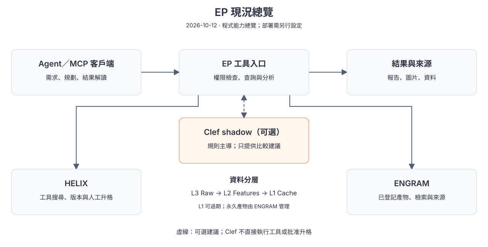

# Evo_PRISM

**執行期智慧、工具演進與可追溯的分析記憶**

[English](README.md) · [繁體中文](README_zh.md)

EP 讓 AI Agent 透過 MCP 查找工具、執行分析、檢索既有成果，並追蹤產物與工具版本。HELIX 管理工具生命週期；ENGRAM 管理已登記產物與來源。生物資訊工具涵蓋 Bulk RNA、單細胞與空間分析；可用能力依安裝的依賴與資料而定。

## 選擇使用方式

| 使用情境 | 起點 | 需要什麼 |
| --- | --- | --- |
| 個人、單一電腦 | [單機指南](docs/guides/SINGLE_USER_zh.md) | 本機 Python、DuckDB、MCP 客戶端；語意搜尋另需 embedding |
| 實驗室、多人或遠端存取 | [實驗室部署](docs/guides/LAB_DEPLOYMENT_zh.md) | 驗證、成員權限、共用儲存與分析 worker |

**個人使用不需先啟用 Clef、Tailscale 或多人分析佇列。** 現有根目錄 Compose 是實驗室部署設定，不是通用的單機預設。

## 快速開始：個人單機

在本機原生檔案系統的 checkout 中，先安裝 Python 3.11 與 uv，再執行：

```bash
uv sync --locked --no-install-project --python 3.12
.venv/bin/python scripts/ep_local.py init --data-dir "$PWD/local-data"
.venv/bin/python scripts/ep_local.py doctor --data-dir "$PWD/local-data"
```

把產生的 `local-data/mcp.json` 中 `mcpServers.ep` 設定加入 MCP 客戶端，先呼叫 `bio_sample_list`。想實際跑完整示範，可執行：

```bash
.venv/bin/python scripts/check_single_user.py
```

[單機設定、診斷與驗證範圍](docs/guides/SINGLE_USER_zh.md)。
## 系統架構



| 元件 | 職責與邊界 |
| --- | --- |
| Agent / MCP | 規劃與工具呼叫；執行仍需通過權限與輸入檢查 |
| HELIX | 工具搜尋、版本與健康追蹤；正式升格需測試與人工審核 |
| ENGRAM | 已登記產物的保存、混合檢索與來源關係；不等於所有對話自動歸檔 |
| L3 / L2 / L1 | 原始資料／結構化特徵／可過期語意快取；永久產物另由 ENGRAM 管理 |
| Clef shadow | 可選的決策比較建議；規則主導，不直接執行工具或批准升格 |

[HELIX／ENGRAM 詳圖與目標流程](docs/guides/ARCHITECTURE_zh.md) · [Clef 設定與紀錄範圍](docs/guides/DECISION_ADVISOR.md)

## 主要功能

| 需求 | 工具入口 |
| --- | --- |
| 先查既有成果 | `bio_history_check`, `bio_history_search`, `bio_read_report` |
| 找工具與分析步驟 | `bio_find_tool`, `bio_get_playbook`, `bio_get_analysis_workflow` |
| 分析與取回產物 | `bio_run_*`, `bio_artifact_search`, `bio_get_artifact`, `bio_get_figure` |
| 版本與影響追蹤 | `bio_tool_health`, `bio_impact`, `bio_compare_versions` |
| 決策建議與回饋 | `bio_decision_status`, `bio_decision_assess`, `bio_decision_feedback` |

可用工具以 MCP 實際列出的清單為準。沙盒執行預設關閉；MCseg 等功能另有模型、GPU 與外部依賴。

## 驗證與限制

乾淨環境安裝、MCP、合成 CPU EDA 與跨連線成果重用的實測範圍記錄於 [單機指南](docs/guides/SINGLE_USER_zh.md)。歷史效能數據與分析測試請見 [測試指南](docs/guides/TESTING.md)；它們不是本次版本所有分析功能或科學正確性的保證。

新建決策 ledger 預設 off。Clef shadow 需要另外配置 bridge 與模型；公開程式包含 client，不包含模型權重或自動啟動的 MLX 服務。shadow 成功不代表已通過獨立品質驗收。

## 文件

- [個人單機](docs/guides/SINGLE_USER_zh.md) · [實驗室部署](docs/guides/LAB_DEPLOYMENT_zh.md) · [進階安裝](docs/guides/INSTALLATION_zh.md)
- [系統架構](docs/guides/ARCHITECTURE_zh.md) · [Decision advisor](docs/guides/DECISION_ADVISOR.md)
- [MCP stdio](docs/guides/MCP_JSON_SETUP.md) · [MCP HTTP](docs/guides/MCP_HTTP_GUIDE.md)
- [分析方法流程圖](docs/guides/ANALYSIS_WORKFLOW_GUIDE.md) · [資料匯入](docs/guides/L3_DATA_INGEST_GUIDE.md)
- [測試](docs/guides/TESTING.md) · [排程與備份](docs/guides/SCHEDULED_TASKS.md)

## 貢獻與授權

歡迎 Issue 與 PR，請先閱讀 [CONTRIBUTING.md](CONTRIBUTING.md)。
MIT License — © 2026 Chan Chi Ru. [LICENSE](LICENSE).
