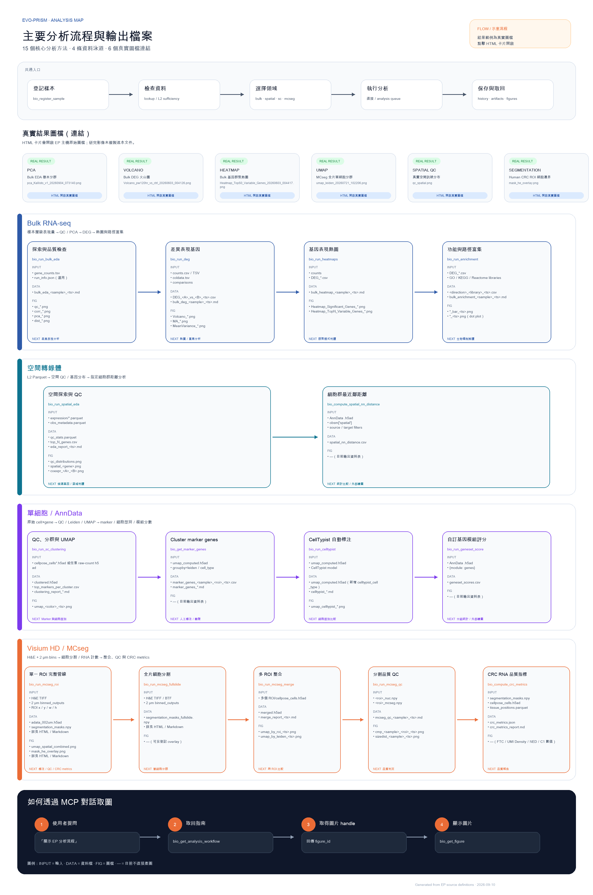

# Evo-PRISM 主要分析流程與輸出檔案

> 2026-10-12：歷史示意；結果連結改為[取用說明](WORKFLOW_STATUS.md)。Bulk EDA 最新輸入契約亦見該頁。

> **SCHEMATIC / 示意**：流程關係是導覽示意；下列結果範例是 EP 主機上的真實圖檔連結，研究影像本身未複製進 Git。

## 真實圖檔連結

下列歷史範例名稱保留；連結指向結果取用說明，不提供研究檔案。

- [PCA — Bulk EDA 樣本分群](https://github.com/ddmanyes/Evo_PRISM/blob/master/docs/guides/WORKFLOW_STATUS.md)
- [VOLCANO — Bulk DEG 火山圖](https://github.com/ddmanyes/Evo_PRISM/blob/master/docs/guides/WORKFLOW_STATUS.md)
- [HEATMAP — Bulk 基因群聚熱圖](https://github.com/ddmanyes/Evo_PRISM/blob/master/docs/guides/WORKFLOW_STATUS.md)
- [UMAP — MCseg 全片單細胞分群](https://github.com/ddmanyes/Evo_PRISM/blob/master/docs/guides/WORKFLOW_STATUS.md)
- [SPATIAL QC — 真實空間訊號分布](https://github.com/ddmanyes/Evo_PRISM/blob/master/docs/guides/WORKFLOW_STATUS.md)
- [SEGMENTATION — Human CRC ROI 細胞邊界](https://github.com/ddmanyes/Evo_PRISM/blob/master/docs/guides/WORKFLOW_STATUS.md)

## 個別方法流程圖

- [探索與品質檢查 — `bio_run_bulk_eda`](../analysis_methods/bio_run_bulk_eda/index.html) · [PNG](../images/analysis_methods/bio_run_bulk_eda.png) · [SVG](../images/analysis_methods/bio_run_bulk_eda.svg)
- [差異表現基因 — `bio_run_deg`](../analysis_methods/bio_run_deg/index.html) · [PNG](../images/analysis_methods/bio_run_deg.png) · [SVG](../images/analysis_methods/bio_run_deg.svg)
- [基因表現熱圖 — `bio_run_heatmaps`](../analysis_methods/bio_run_heatmaps/index.html) · [PNG](../images/analysis_methods/bio_run_heatmaps.png) · [SVG](../images/analysis_methods/bio_run_heatmaps.svg)
- [功能與路徑富集 — `bio_run_enrichment`](../analysis_methods/bio_run_enrichment/index.html) · [PNG](../images/analysis_methods/bio_run_enrichment.png) · [SVG](../images/analysis_methods/bio_run_enrichment.svg)
- [空間探索與 QC — `bio_run_spatial_eda`](../analysis_methods/bio_run_spatial_eda/index.html) · [PNG](../images/analysis_methods/bio_run_spatial_eda.png) · [SVG](../images/analysis_methods/bio_run_spatial_eda.svg)
- [細胞群最近鄰距離 — `bio_compute_spatial_nn_distance`](../analysis_methods/bio_compute_spatial_nn_distance/index.html) · [PNG](../images/analysis_methods/bio_compute_spatial_nn_distance.png) · [SVG](../images/analysis_methods/bio_compute_spatial_nn_distance.svg)
- [QC、分群與 UMAP — `bio_run_sc_clustering`](../analysis_methods/bio_run_sc_clustering/index.html) · [PNG](../images/analysis_methods/bio_run_sc_clustering.png) · [SVG](../images/analysis_methods/bio_run_sc_clustering.svg)
- [Cluster marker genes — `bio_get_marker_genes`](../analysis_methods/bio_get_marker_genes/index.html) · [PNG](../images/analysis_methods/bio_get_marker_genes.png) · [SVG](../images/analysis_methods/bio_get_marker_genes.svg)
- [CellTypist 自動標注 — `bio_run_celltypist`](../analysis_methods/bio_run_celltypist/index.html) · [PNG](../images/analysis_methods/bio_run_celltypist.png) · [SVG](../images/analysis_methods/bio_run_celltypist.svg)
- [自訂基因模組評分 — `bio_run_geneset_score`](../analysis_methods/bio_run_geneset_score/index.html) · [PNG](../images/analysis_methods/bio_run_geneset_score.png) · [SVG](../images/analysis_methods/bio_run_geneset_score.svg)
- [單一 ROI 完整管線 — `bio_run_mcseg_roi`](../analysis_methods/bio_run_mcseg_roi/index.html) · [PNG](../images/analysis_methods/bio_run_mcseg_roi.png) · [SVG](../images/analysis_methods/bio_run_mcseg_roi.svg)
- [全片細胞分割 — `bio_run_mcseg_fullslide`](../analysis_methods/bio_run_mcseg_fullslide/index.html) · [PNG](../images/analysis_methods/bio_run_mcseg_fullslide.png) · [SVG](../images/analysis_methods/bio_run_mcseg_fullslide.svg)
- [多 ROI 整合 — `bio_run_mcseg_merge`](../analysis_methods/bio_run_mcseg_merge/index.html) · [PNG](../images/analysis_methods/bio_run_mcseg_merge.png) · [SVG](../images/analysis_methods/bio_run_mcseg_merge.svg)
- [分割品質 QC — `bio_run_mcseg_qc`](../analysis_methods/bio_run_mcseg_qc/index.html) · [PNG](../images/analysis_methods/bio_run_mcseg_qc.png) · [SVG](../images/analysis_methods/bio_run_mcseg_qc.svg)
- [CRC RNA 品質指標 — `bio_compute_crc_metrics`](../analysis_methods/bio_compute_crc_metrics/index.html) · [PNG](../images/analysis_methods/bio_compute_crc_metrics.png) · [SVG](../images/analysis_methods/bio_compute_crc_metrics.svg)

## 共通流程

1. `bio_register_sample` 登記樣本與 L3 路徑。
2. 用 `bio_lookup_sample` 與 `bio_check_l2_sufficiency` 檢查資料狀態。
3. 選擇 Bulk、Spatial、Single-cell 或 MCseg 領域工具。
4. 重量分析可由 `bio_submit_analysis` 進入持久化佇列。
5. 結果寫入 analysis history；圖片以 `figure_id` 由 `bio_get_figure` 取回。

## Bulk RNA-seq

樣本層級表現量 → QC／PCA → DEG → 熱圖與路徑富集

### 1. 探索與品質檢查

- MCP 方法：`bio_run_bulk_eda`
- 輸入：`gene_counts.tsv`；`run_info.json（選用）`
- 資料檔：`bulk_eda_<sample>_<ts>.md`
- 圖檔：`qc_*.png`；`corr_*.png`；`pca_*.png`；`dist_*.png`
- 後續：差異表現分析

### 2. 差異表現基因

- MCP 方法：`bio_run_deg`
- 輸入：`counts.csv／TSV`；`coldata.tsv`；`comparisons`
- 資料檔：`DEG_<A>_vs_<B>_<ts>.csv`；`bulk_deg_<sample>_<ts>.md`
- 圖檔：`Volcano_*.png`；`MA_*.png`；`MeanVariance_*.png`
- 後續：熱圖／富集分析

### 3. 基因表現熱圖

- MCP 方法：`bio_run_heatmaps`
- 輸入：`counts`；`DEG_*.csv`
- 資料檔：`bulk_heatmap_<sample>_<ts>.md`
- 圖檔：`Heatmap_Significant_Genes_*.png`；`Heatmap_TopN_Variable_Genes_*.png`
- 後續：群聚模式判讀

### 4. 功能與路徑富集

- MCP 方法：`bio_run_enrichment`
- 輸入：`DEG_*.csv`；`GO／KEGG／Reactome libraries`
- 資料檔：`<direction>_<library>_<ts>.csv`；`bulk_enrichment_<sample>_<ts>.md`
- 圖檔：`*_bar_<ts>.png`；`*_<ts>.png（dot plot）`
- 後續：生物機制解讀

## 空間轉錄體

L2 Parquet → 空間 QC／基因分布 → 指定細胞群距離分析

### 1. 空間探索與 QC

- MCP 方法：`bio_run_spatial_eda`
- 輸入：`expression/*.parquet`；`obs_metadata.parquet`
- 資料檔：`qc_stats.parquet`；`top_N_genes.csv`；`eda_report_<ts>.md`
- 圖檔：`qc_distributions.png`；`spatial_<gene>.png`；`coexpr_<A>_<B>.png`
- 後續：候選基因／區域判讀

### 2. 細胞群最近鄰距離

- MCP 方法：`bio_compute_spatial_nn_distance`
- 輸入：`AnnData .h5ad`；`obsm['spatial']`；`source／target filters`
- 資料檔：`spatial_nn_distance.csv`
- 圖檔：`—（目前輸出資料表）`
- 後續：統計比較／外部繪圖

## 單細胞／AnnData

原始 cell×gene → QC／Leiden／UMAP → marker／細胞型別／模組分數

### 1. QC、分群與 UMAP

- MCP 方法：`bio_run_sc_clustering`
- 輸入：`cellpose_cells*.h5ad 或任意 raw-count h5ad`
- 資料檔：`clustered.h5ad`；`top_markers_per_cluster.csv`；`clustering_report_*.md`
- 圖檔：`umap_<color>_<ts>.png`
- 後續：Marker 與細胞型別

### 2. Cluster marker genes

- MCP 方法：`bio_get_marker_genes`
- 輸入：`umap_computed.h5ad`；`groupby=leiden／cell_type`
- 資料檔：`marker_genes_<sample>_<roi>_<ts>.csv`；`marker_genes_*.md`
- 圖檔：`—（目前輸出資料表）`
- 後續：人工標注／驗證

### 3. CellTypist 自動標注

- MCP 方法：`bio_run_celltypist`
- 輸入：`umap_computed.h5ad`；`CellTypist model`
- 資料檔：`umap_computed.h5ad（新增 celltypist_cell_type）`；`celltypist_*.md`
- 圖檔：`umap_celltypist_*.png`
- 後續：細胞型別比較

### 4. 自訂基因模組評分

- MCP 方法：`bio_run_geneset_score`
- 輸入：`AnnData .h5ad`；`{module: genes}`
- 資料檔：`geneset_scores.csv`
- 圖檔：`—（目前輸出資料表）`
- 後續：分組統計／外部繪圖

## Visium HD／MCseg

H&E＋2 µm bins → 細胞分割／RNA 計數 → 整合、QC 與 CRC metrics

### 1. 單一 ROI 完整管線

- MCP 方法：`bio_run_mcseg_roi`
- 輸入：`H&E TIFF`；`2 µm binned_outputs`；`ROI x／y／w／h`
- 資料檔：`adata_002um.h5ad`；`segmentation_masks.npy`；`cellpose_cells.h5ad`；`Xenium bundle`
- 圖檔：`umap_spatial_combined.png`；`mask_he_overlay.png`；`mask_he_boundary.png`；`skin_markers_dotplot.png`
- 後續：標注／QC／CRC metrics

### 2. 全片細胞分割

- MCP 方法：`bio_run_mcseg_fullslide`
- 輸入：`H&E TIFF／BTF`；`2 µm binned_outputs`
- 資料檔：`segmentation_masks_fullslide.npy`；`segmentation_masks_fullslide_vfr.npy`；`cellpose_cells_fullslide.h5ad`
- 圖檔：`—（可另登記 overlay）`
- 後續：單細胞分群

### 3. 多 ROI 整合

- MCP 方法：`bio_run_mcseg_merge`
- 輸入：`多個 ROI/cellpose_cells.h5ad`
- 資料檔：`merged.h5ad`；`merge_report_<ts>.md`
- 圖檔：`umap_by_roi_<ts>.png`；`umap_by_leiden_<ts>.png`
- 後續：跨 ROI 比較

### 4. 分割品質 QC

- MCP 方法：`bio_run_mcseg_qc`
- 輸入：`<roi>_nuc.npy`；`<roi>_mcseg.npy`
- 資料檔：`mcseg_qc_<sample>_<ts>.md`
- 圖檔：`cmp_<sample>_<roi>_<ts>.png`；`sizedist_<sample>_<ts>.png`
- 後續：品質判定

### 5. CRC RNA 品質指標

- MCP 方法：`bio_compute_crc_metrics`
- 輸入：`segmentation_masks.npy`；`cellpose_cells.h5ad`；`tissue_positions.parquet`
- 資料檔：`crc_metrics.json`；`crc_metrics_report.md`
- 圖檔：`—（FTC／UMI Density／NED／C1 數值）`
- 後續：品質報告

## MCP 對話取圖

呼叫 `bio_get_analysis_workflow(domain=...)`，其中 domain 可為 `overview`、`bulk`、`spatial`、`single_cell` 或 `mcseg`。工具回傳的 inline PNG 會由 MCP 邊界轉為 `figure_id`；再呼叫 `bio_get_figure(figure_id=...)` 即可在支援多模態的用戶端顯示圖片。
