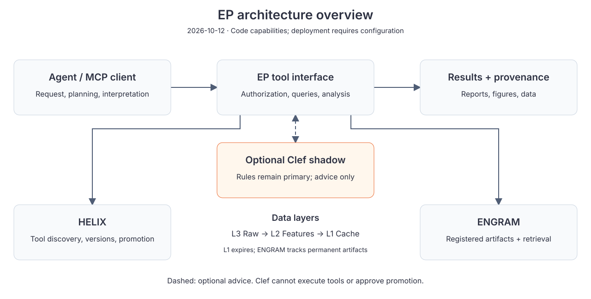
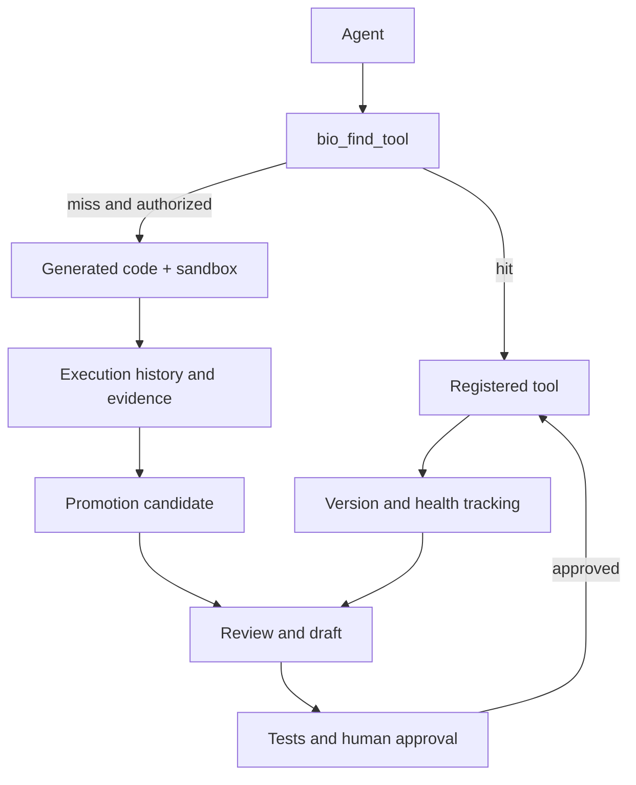
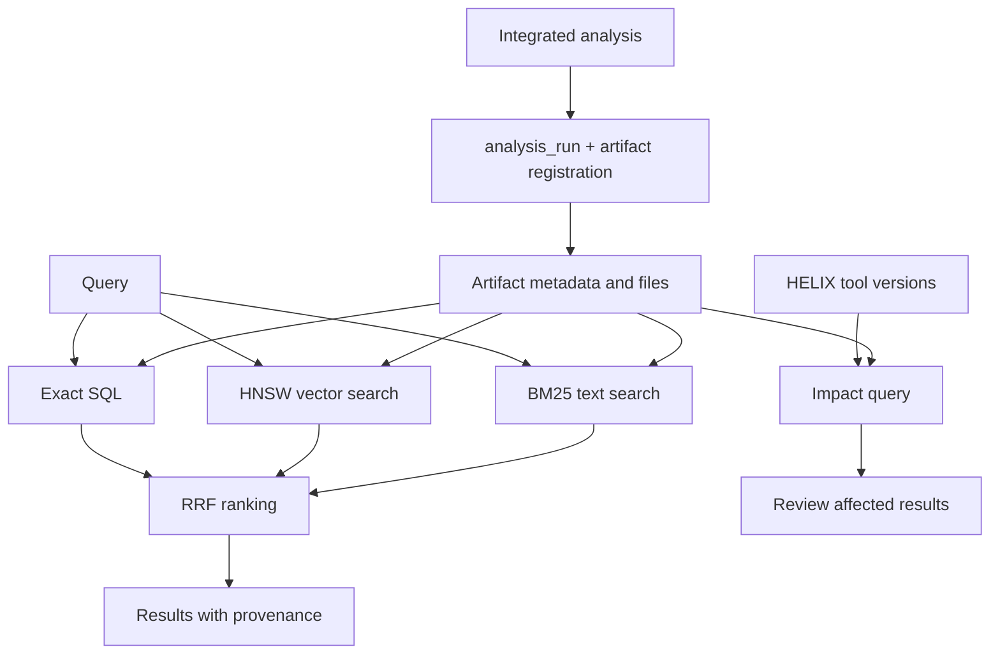

# EP architecture and workflows

[README](../../README.md) · [English](ARCHITECTURE.md) · [繁體中文](ARCHITECTURE_zh.md)

Scope: code capabilities as of 2026-10-12. Configuration and status determine what is enabled in a deployment.

## HELIX

Tool discovery and formal promotion are distinct. Reuse counts identify candidates; they do not replace tests or human approval. Health tracking provides diagnostic evidence, not a guarantee of scientific validity.

This diagram summarizes component relationships, not an automatically scheduled chain. tool_registry tracks versions and hot spots; code_promoter.approve_candidate performs formal promotion. Diagnostic snapshots and downsampling are maintenance capabilities; token cost depends on the model.

## ENGRAM

Integrated analyses use analysis_run for state, provenance and artifact registration. Unregistered conversation conclusions, notes and arbitrary sandbox files must not be described as permanently archived.

Vector and text retrieval depend on indexes and backend availability and can degrade when a path is unavailable. Impact tracking identifies results to review, not an automatic obligation to rerun. L3 raw data is immutable; L2 holds features and L1 is an expiring cache, separate from permanent artifacts.

## Decision advice and observations

External MCP clients choose whether to call bio_decision_assess; the Web Agent prompt recommends it for suitable analysis tasks. Rules provide the primary suggestion. Optional Clef shadow scores the same metadata, with guarded comparison results recorded; it does not invoke analysis tools.

Tool observations store call IDs, outcomes, duration and bounded content fingerprints, not complete conversations or research data. They do not automatically become training labels. See [Decision advisor](DECISION_ADVISOR.md).

## Target workflows: not fully accepted

The 2026-10-07/08 Second Brain diagrams informed this design. The four workflow categories below are targets, not a claim that all are deployed.

| Workflow | Existing foundation | Requires separate acceptance |
| --- | --- | --- |
| First analysis | Registered tools, analysis_run, artifact registration | Complete archiving and permanent notes for arbitrary analyses |
| Reuse | History and artifact lookup | End-to-end provenance for direct citation and reinterpretation into new reports |
| Sandbox extension | Discovery, gated sandbox, execution records | General historical-code search and universal artifact registration |
| Independent evolution | Versions, hot spots, candidates and human promotion | Complete independent model integration for parameterization and sandbox promotion |

Legacy images remain for historical comparison, not as current specifications:
[EP](../images/figure_1_system_arch.png) · [HELIX](../images/figure_2_system_arch.png) · [ENGRAM](../images/figure_3_system_arch_1.png).

Code references: [Agent](../../server/agent.py), [tool catalog](../../server/tool_catalog.py), [HELIX](../../analysis/code_promoter.py), [ENGRAM](../../analysis/artifact_registry.py), [analysis_run](../../analysis/run_context.py).
