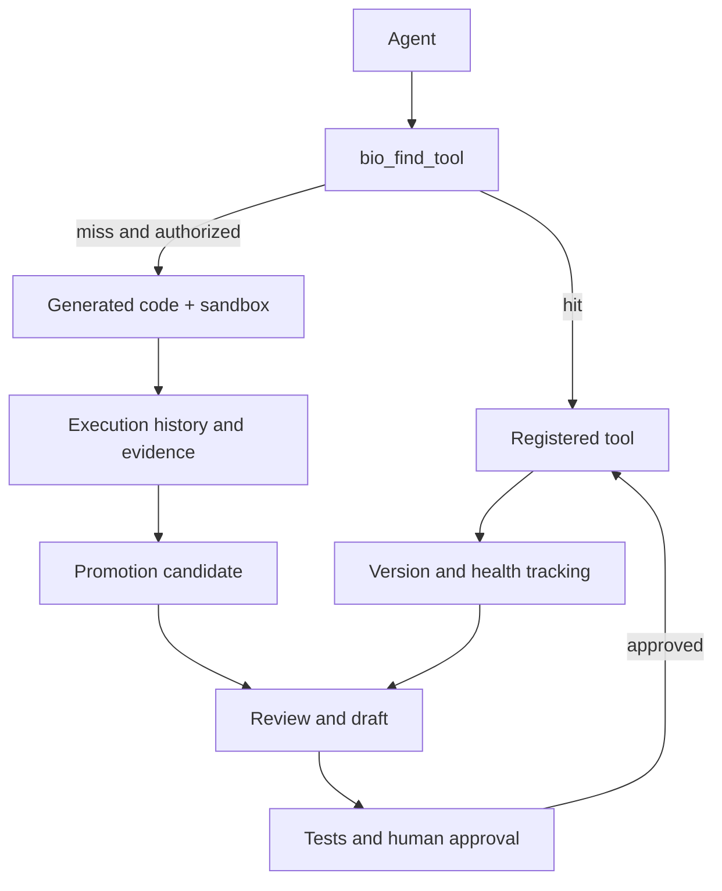
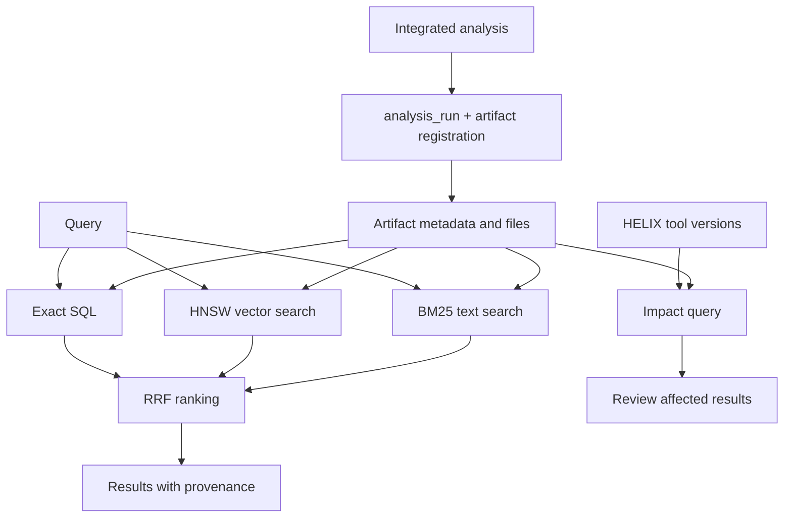

# EP 架構與流程

[README](../../README_zh.md) · [English](ARCHITECTURE.md) · [繁體中文](ARCHITECTURE_zh.md)

範圍：2026-10-12 程式能力；個別部署是否啟用仍需查看設定與狀態。

## HELIX

工具探索與正式升格是不同步驟。重用次數是候選訊號，不能取代測試或人工批准。健康追蹤提供診斷證據，不保證科學方法正確。

此圖概括元件關係，不表示所有箭頭均由背景排程自動觸發。版本與熱區由 tool_registry 管理；code_promoter 的 approve_candidate 才負責正式升格。診斷快照與降採樣屬可配置的維護功能，token 成本依模型而異。

## ENGRAM

已整合的分析透過 analysis_run 保存狀態、來源及產物登記。未經登記的對話結論、Note 或任意沙盒檔案，不應宣稱已永久歸檔。

向量／全文檢索依賴索引與後端可用性，缺少某路時可能退化。影響追蹤表示結果值得檢查，不等於必須重算。L3 原始資料保持不可變；L2 保存特徵，L1 是可過期快取，與永久分析產物分開。

## 決策與紀錄

外部 MCP 客戶端需主動呼叫 bio_decision_assess；Web Agent 的提示詞建議在合適分析任務前呼叫。規則提供主要建議，Clef shadow 可選地評分相同 metadata，經 guard 檢查後記錄比較結果；不直接呼叫分析工具。

工具觀測只保存 call ID、結果狀態、耗時與有界內容指紋；不包含完整對話或研究資料，也不自動構成訓練標籤。詳見 [Decision advisor](DECISION_ADVISOR.md).

## 目標流程：尚未全面驗收

SB 的 2026-10-07／08 圖組是設計來源；以下保留其四流程分類，但不是全部已部署的聲明。

| 流程 | 既有基礎 | 仍需逐項驗證 |
| --- | --- | --- |
| 首次分析 | 正式工具、analysis_run、產物登記 | 任意分析的完整歸檔與永久 Note |
| 成果重用 | 歷史與產物查詢 | 2A 直接引用與 2B 重解讀後新報告的完整來源契約 |
| 沙盒擴充 | 工具搜尋、授權沙盒、執行紀錄 | 通用歷史程式搜尋與所有產物自動登記 |
| 獨立工具演進 | 版本、熱區、候選與人工升格 | 4A 參數化、4B 沙盒升格的完整獨立模型整合 |

舊圖保留供歷史對照，不作現況依據：
[EP](../images/figure_1_system_arch.png) · [HELIX](../images/figure_2_system_arch.png) · [ENGRAM](../images/figure_3_system_arch_1.png).

程式依據： [Agent](../../server/agent.py), [tool catalog](../../server/tool_catalog.py), [HELIX](../../analysis/code_promoter.py), [ENGRAM](../../analysis/artifact_registry.py), [analysis_run](../../analysis/run_context.py).
